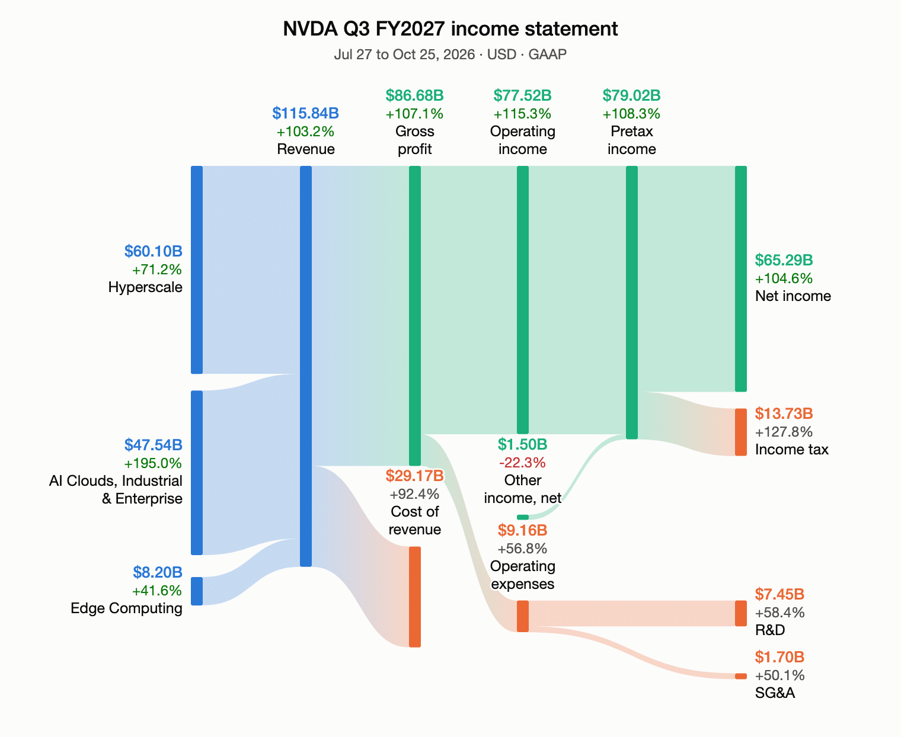
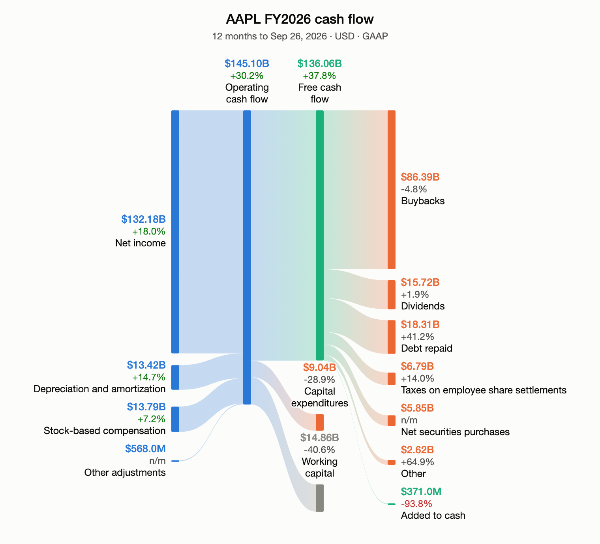
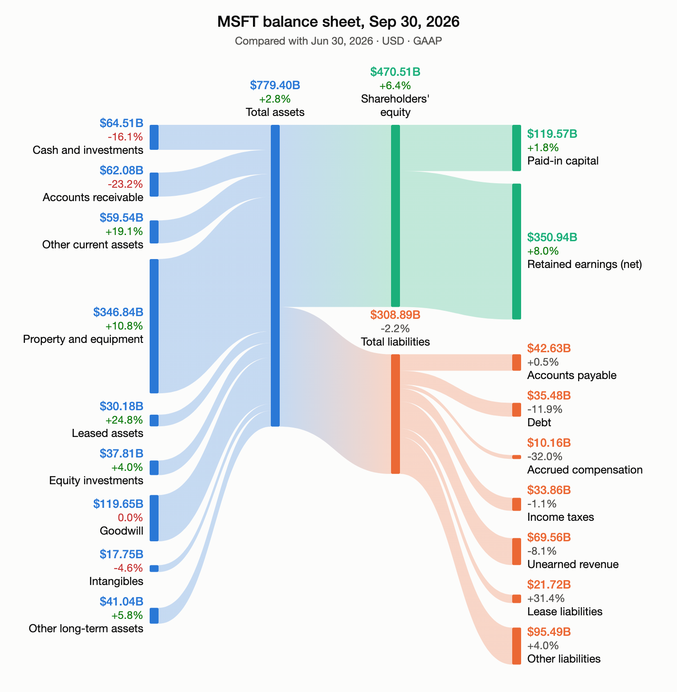
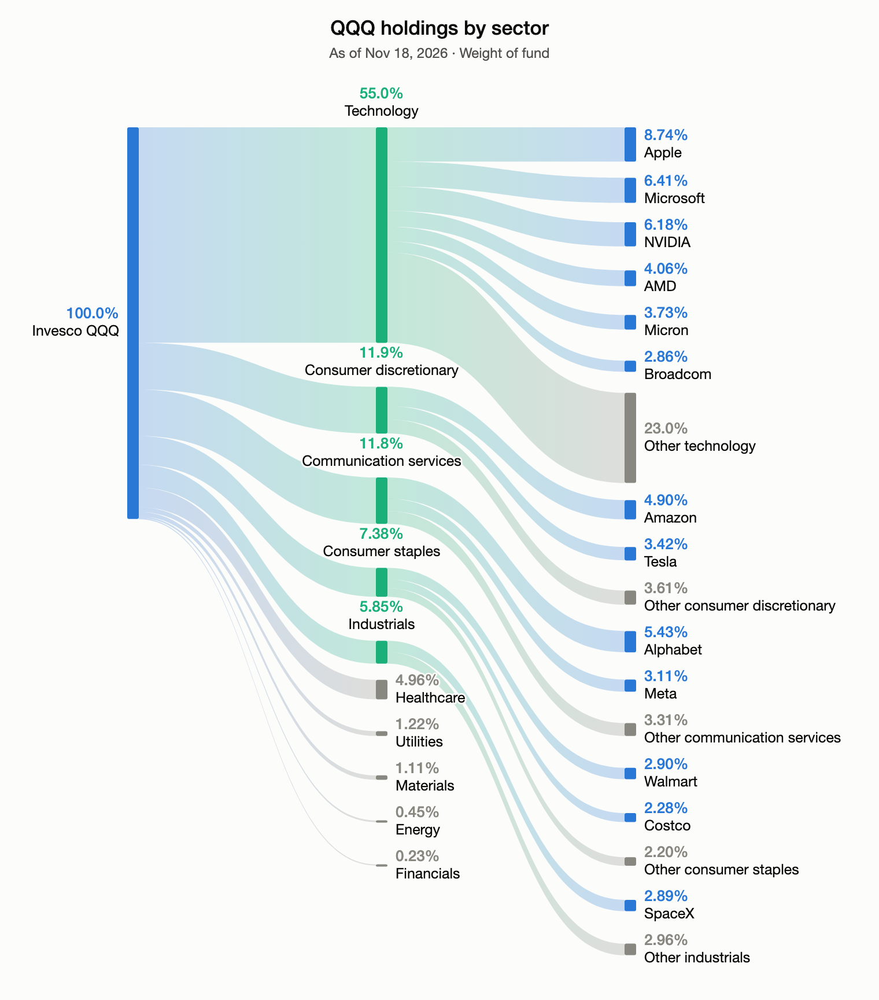
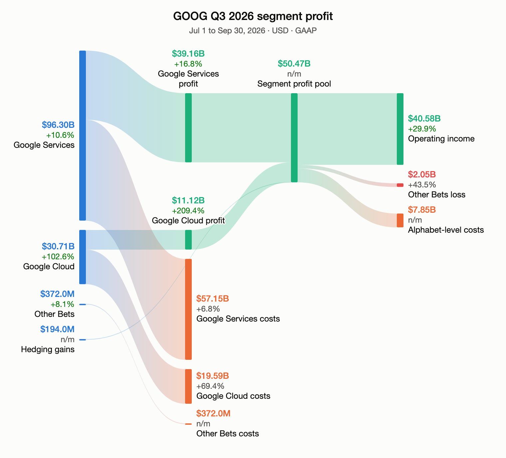

# sankey-financials

Interactive Sankey diagrams that answer one question: **where did the money come from, and where did it go?**

Give it a ticker and get a chart of the latest quarter's income statement. Link widths are proportional to dollars, profit runs along the top, costs branch off below, and every number is checked against the reported totals before it is drawn.

<p align="center">
  
</p>

It works as an AI agent skill (Claude Code, and any agent that can read a markdown instruction file) and as a plain command-line tool with no LLM at all.

## What it draws

| Flow | Ask for | What you see |
|---|---|---|
| **Income statement** | "NVDA latest quarter", revenue breakdown, P&L | Revenue by product, business or geography, flowing into gross profit, operating income, net income, with costs and taxes branching off |
| **Cash flow** | "AAPL cash flow", free cash flow, buybacks | Operating cash flow into capex, buybacks, dividends, debt and the change in cash |
| **Balance sheet** | "MSFT balance sheet" | Assets on one side, liabilities and equity on the other |
| **Holdings** | "what's in QQQ", "DRAM breakdown" | An ETF or fund split into sectors and individual holdings |
| **Segments** | "which Alphabet segment makes the money" | Segment revenue and operating profit |

<table>
<tr>
<td><br><sub>Cash flow</sub></td>
<td><br><sub>Balance sheet</sub></td>
</tr>
<tr>
<td><br><sub>ETF holdings</sub></td>
<td><br><sub>Segment profit</sub></td>
</tr>
</table>

Open the live, interactive charts (hover, switch tabs, toggle Y/Y):
[NVIDIA income statement](https://patelkev.github.io/sankey-financials/gallery/nvda_income.html) ·
[Apple cash flow](https://patelkev.github.io/sankey-financials/gallery/aapl_cash.html) ·
[Microsoft balance sheet](https://patelkev.github.io/sankey-financials/gallery/msft_balance.html) ·
[QQQ holdings](https://patelkev.github.io/sankey-financials/gallery/qqq_holdings.html) ·
[DRAM ETF holdings](https://patelkev.github.io/sankey-financials/gallery/dram_holdings.html) ·
[Alphabet segments](https://patelkev.github.io/sankey-financials/gallery/goog_segments.html) ·
[all source files](gallery/).

## Features

- **Numbers must reconcile.** Line items are checked against reported totals (revenue, operating income, net income, cash change). A mismatch is a hard error, never a silent fix.
- **Interactive.** Tabs for Product / Business / Geography views, a year-over-year switch, hover tracing with tooltips, and click-a-box-to-ask.
- **Edge cases handled.** Operating losses, tax benefits, negative equity, gains inside operating expenses, and tiny flows (drawn at a 2px minimum).
- **Self-contained output.** Each chart is a single HTML file with no external scripts, fonts or network calls.
- **Zero dependencies.** Python 3 and Node standard libraries only. Playwright is optional, for the browser layout check.

## Set it up with your coding agent

Copy the repository link and paste this prompt into your coding agent (Claude Code, Codex, Cursor, Gemini CLI, or similar):

```text
Set up this repo for me: https://github.com/patelkev/sankey-financials
Read its AGENTS.md and follow the setup steps. Install it for the environment you are
running in, run the test suite to verify, then tell me what to say to make my first chart.
```

The agent will check that Python and Node are present, install the skill in the right place for itself, run `./run_tests.sh`, and report back with example prompts. The steps it follows are in [`AGENTS.md`](AGENTS.md), so you can read exactly what it will do first.

## Manual install

**Claude Code, as a plugin**

```text
/plugin marketplace add patelkev/sankey-financials
/plugin install sankey-financials
```

**Claude Code, as a skill folder**

```bash
git clone https://github.com/patelkev/sankey-financials.git
cp -R sankey-financials/skills/sankey-financials ~/.claude/skills/
```

**Other agents.** Keep the folder somewhere stable and add one line to your agent's instruction file (`AGENTS.md`, `.cursorrules`, `GEMINI.md`):

> To chart company or fund financials, read `<path>/skills/sankey-financials/SKILL.md` and follow it.

The agent needs to be able to browse or read filings to find the numbers.

## Using it

In your agent, ask in plain language:

```text
NVDA latest quarter
AAPL cash flow Sankey, last fiscal year
MSFT balance sheet
what's in QQQ?
which Alphabet segment makes the money?
```

With only a ticker, you get the **latest reported quarter, GAAP, income statement**, with Product, Business and Geography tabs where the filing supports them.

How it works:

1. The agent finds the numbers in a primary source (earnings release, 10-Q or 10-K, or the fund's holdings page), including the same period a year earlier.
2. It writes a small **spec** JSON of line items as the filing reports them.
3. `make.py` builds the chart structure and verifies the arithmetic. `test.js` checks the layout. `build.py` produces the HTML.

The agent supplies judgment (which filing, how to group small lines). The scripts do everything else.

## Use it without an LLM

You only need a spec file. Start from any file in [`skills/sankey-financials/examples/`](skills/sankey-financials/examples/):

```bash
S=skills/sankey-financials
python3 $S/scripts/make.py $S/examples/nvda_income.json nvda.cfg.json   # build + reconcile
node    $S/scripts/test.js nvda.cfg.json -q                             # layout checks
python3 $S/scripts/build.py nvda.cfg.json nvda.html --standalone        # write the page
open nvda.html
```

Details: [docs/without-an-llm.md](docs/without-an-llm.md). Spec format for every flow type: [spec-format.md](skills/sankey-financials/references/spec-format.md).

A minimal income spec looks like this (amounts in $ millions, `[current, prior]`):

```json
{"flow":"income","company":"Example Co","ticker":"EXM","period":"Q1 2027","dates":"Jan 1 to Mar 31, 2027","basis":"GAAP",
 "source":"Q1 2027 earnings release",
 "views":{"Product":{"items":[{"l":"Hardware","v":600,"p":500},{"l":"Services","v":400,"p":300}]}},
 "revenue":[1000,800],"cogs":[400,350],
 "opex":[{"l":"R&D","v":150,"p":120},{"l":"SG&A","v":100,"p":90}],
 "operating_income":[350,240],"nonop":[],"tax":[70,48],"net_income":[280,192]}
```

## Limits

`make.py` refuses cases it cannot draw honestly and says why: gross loss, a pretax loss despite an operating profit, and a total operating loss in the segment view. Describe those in text instead.

Mappings are judgment calls in some places (for example, assigning ETF holdings to sectors, or combining shares and swaps on the same company). The agent should say when it makes one, and derived lines are labeled "Derived" in their tooltips.

## Compatibility

| Part | Needs |
|---|---|
| Chart engine (`make.py`, `test.js`, `build.py`, `engine.js`) | Python 3.9+, Node 18+. Works with any model or none. |
| `SKILL.md` workflow | An agent that reads markdown instructions and can fetch filings. Written for Claude Code, portable to others. |
| Click-a-box-to-ask | Copies a question to your clipboard in the standalone page. In a chat UI that supports inline widgets (such as claude.ai), build without `--standalone` and clicking asks the assistant directly. |
| Browser layout check | Playwright (optional) |

## Data and disclaimers

Example charts use public figures from company filings and fund holdings pages. Always verify against the primary source before relying on a number. This is a visualization tool, not financial advice.

## Contributing

See [CONTRIBUTING.md](CONTRIBUTING.md). Run `./run_tests.sh` in `skills/sankey-financials/` until it prints ALL PASSED.

## License

[MIT](LICENSE)
